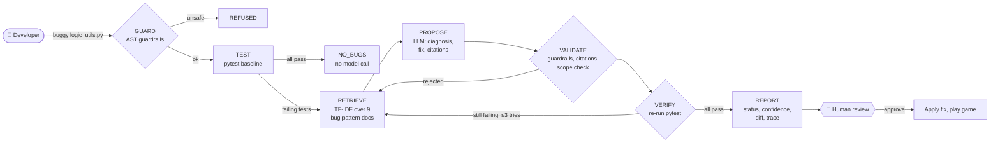

# 🕵️ Glitch Investigator AI

**An AI debugging agent that finds, explains and fixes logic bugs, grounds every fix in a knowledge base of known bug patterns, and only reports success when the test suite proves it.**

You give it a broken version of a game's logic module. It runs the tests to see what is really broken, retrieves the matching bug patterns, asks an LLM for a diagnosis and a fix, checks that fix with guardrails and the tests, and retries with the new evidence if anything still fails. The result is a status, a confidence score, a readable diagnosis and a diff that **a human approves before anything changes**.

> AI-written code often *looks* right while being quietly wrong. This project is about building an AI tool you can actually trust: one that shows its evidence, cites its sources, refuses unsafe input, and says how sure it is.

---

## 📦 Where this started: Game Glitch Investigator (Module 1)

This project extends my Module 1 project, **[Game Glitch Investigator: The Impossible Guesser](https://github.com/OmarTorky-dev/Game-Glitch-Investigator)**. In that project I was given a Streamlit number-guessing game written by an AI that "ran away": the hints lied, New Game didn't reset, scoring went haywire and Hard was easier than Normal. I reproduced each bug, fixed them by hand, moved the game logic into `logic_utils.py`, and grew the test suite from 3 to 15 tests. The original write-up is preserved in [docs/module1_README.md](docs/module1_README.md) and [docs/module1_reflection.md](docs/module1_reflection.md).

**What's new in the final project:** the manual debugging process I followed in Module 1 (reproduce, look up the bug pattern, fix the root cause, re-test) is now an **AI agent** with retrieval (RAG), a self-checking fix loop, guardrails, confidence scoring, logging and an evaluation harness. It's built into the original Streamlit app as a new tab and is also available as a CLI.

---

## 🏗️ Architecture overview

Full diagram source: [diagrams/architecture.mmd](diagrams/architecture.mmd)



| Component | File | What it does |
|---|---|---|
| **Guardrails** | [glitch_ai/guardrails.py](glitch_ai/guardrails.py) | Parses code with `ast` *without running it*. Blocks dangerous imports (`os`, `subprocess`, `socket`…) and calls (`eval`, `exec`, `open`…), enforces size limits and the four-function API contract. Also powers the **scope check**, which flags edits to functions no failing test covers. |
| **Sandbox** | [glitch_ai/sandbox.py](glitch_ai/sandbox.py) | Runs the 15 behaviour tests against the candidate code in a temp folder, in a subprocess with a 30 s timeout. Refuses to run anything the guardrails reject. |
| **Retriever (RAG)** | [glitch_ai/retriever.py](glitch_ai/retriever.py), [knowledge_base/](glitch_ai/knowledge_base/) | TF-IDF search over 9 bug-pattern documents I wrote from my Module 1 bug log (string-vs-int comparison, swapped hints, off-by-one, scoring sign errors…). The query is the **failing tests**, weighted 2×, plus the code. |
| **LLM client** | [glitch_ai/llm.py](glitch_ai/llm.py) | Calls Gemini (`gemini-3.6-flash`) or Claude with **structured JSON output** (diagnosis, cited doc IDs, change list, full fixed file, self-confidence). `record` mode saves responses; `replay` mode reproduces them offline. |
| **Agent** | [glitch_ai/agent.py](glitch_ai/agent.py) | The plan, act and check loop shown above, plus confidence scoring and a JSONL trace of every step in `logs/runs.jsonl`. |
| **Interfaces** | [app.py](app.py), [investigator_ui.py](investigator_ui.py), [investigate.py](investigate.py) | Streamlit app with a 🎮 **Play** tab (the original game) and a 🕵️ **AI Investigator** tab, plus a CLI. |

**Where humans and tests check the AI:** the test suite checks every proposed fix before it is reported; the guardrails check both the input and the AI's output; and nothing is ever applied automatically, because a person reads the diagnosis, confidence and diff and decides.

---

## ⚙️ Setup

Requires **Python 3.10+** (developed on 3.14, Windows 11).

```bash
# 1. Clone and enter the project
git clone https://github.com/OmarTorky-dev/applied-ai-system-project.git
cd applied-ai-system-project

# 2. Create a virtual environment and install dependencies
python -m venv .venv
.venv\Scripts\activate          # Windows
# source .venv/bin/activate     # macOS / Linux
pip install -r requirements.txt

# 3. (Optional) add an API key to run the model live
copy .env.example .env          # Windows  (cp on macOS / Linux)
# then edit .env and set GEMINI_API_KEY=...  (free at https://aistudio.google.com)
#   or ANTHROPIC_API_KEY=...  to use Claude instead
```

**No API key? Everything still runs.** Without a key the agent uses **replay mode**: it answers from the real Gemini responses recorded in [recordings/](recordings/), so the bundled samples reproduce exactly the outputs shown below.

```bash
# Run the tests (48 tests, no API key needed)
python -m pytest

# Investigate a buggy file from the command line
python investigate.py samples/lying_hints.py

# Launch the app (game + AI Investigator tab)
python -m streamlit run app.py
```

CLI options: `--mode {auto,live,record,replay}`, `--provider {auto,gemini,claude}`, `--max-iters N`, `--out fixed.py` (writes the fix to a new file; it refuses to overwrite the input).

---

## 💬 Sample interactions

All outputs below come from real runs against `gemini-3.6-flash`, made in `record` mode so they can be replayed. Long sections are trimmed where marked `[...]`; the complete, untrimmed logs with every diff are in [eval/sample_runs/](eval/sample_runs/). You can reproduce any of them without a key: `python investigate.py samples/<name>.py --mode replay`.

### 1. Lying hints: RAG retrieves the right bug patterns and the fix is verified

**Input:** [samples/lying_hints.py](samples/lying_hints.py), where `check_guess` compares numbers as strings and has its hint messages swapped (the exact bug from Module 1).

```text
$ python investigate.py samples/lying_hints.py --mode record --provider gemini

=== Glitch Investigator run fc6ca7fa  [gemini (gemini-3.6-flash) [recording]] ===
🛡️  GUARD     Input passed static safety and contract checks.
🧪 TEST      Baseline: 11/15 tests passed
📚 RETRIEVE  Attempt 1: KB02 (0.54), KB01 (0.37), KB07 (0.25)
🤖 PROPOSE   Attempt 1: model cites ['KB01', 'KB02'], self-confidence 1.00
✅ VALIDATE  Proposed fix passed guardrails and scope check.
🔁 VERIFY    Attempt 1: 15/15 tests passed
📋 REPORT    FIXED (confidence 1.00)

--- Result ---
Status      : FIXED
Confidence  : 1.00
Tests       : before = 11/15 tests passed | after = 15/15 tests passed
Grounded in : KB01, KB02
Summary     : Fixed in 1 attempt(s): 15/15 tests passed. Review the diff before applying.

Diagnosis:
In `check_guess`, `guess` and `secret` were converted to strings before comparison
(`g, s = str(guess), str(secret)`), leading to string lexicographical comparisons where
e.g. "9" > "50". Additionally, the hint messages were swapped: when `guess > secret`
("Too High"), the message incorrectly advised "Go HIGHER!", and when `guess < secret`
("Too Low"), it incorrectly advised "Go LOWER!".

Changes:
  - Removed string conversion in `check_guess` so `guess` and `secret` are compared numerically.
  - Swapped hint messages in `check_guess` so 'Too High' suggests '📉 Go LOWER!' and 'Too Low' suggests '📈 Go HIGHER!'.

Proposed diff:
[... header-comment removal trimmed ...]
@@ -28,10 +24,9 @@
 def check_guess(guess, secret):
     if guess == secret:
         return "Win", "🎉 Correct!"
-    g, s = str(guess), str(secret)
-    if g > s:
-        return "Too High", "📈 Go HIGHER!"
-    return "Too Low", "📉 Go LOWER!"
+    if guess > secret:
+        return "Too High", "📉 Go LOWER!"
+    return "Too Low", "📈 Go HIGHER!"
```

The retriever ranked **KB02 (swapped hint messages)** and **KB01 (numbers compared as strings)** highest using only the failing test names and assertions. The model used those documents' vocabulary in its diagnosis and cited exactly those two.

### 2. The full original starter code: four bug classes, fixed in one pass

**Input:** [samples/original_starter.py](samples/original_starter.py), the original AI-generated logic with every bug at once, including the `try/except TypeError` "safety net" that hid the string comparison.

```text
$ python investigate.py samples/original_starter.py --mode record --provider gemini
[...]
🧪 TEST      Baseline: 8/15 tests passed
📚 RETRIEVE  Attempt 1: KB02 (0.47), KB01 (0.32), KB05 (0.32)
🤖 PROPOSE   Attempt 1: model cites ['KB01', 'KB02', 'KB05'], self-confidence 1.00
✅ VALIDATE  Proposed fix passed guardrails and scope check.
🔁 VERIFY    Attempt 1: 15/15 tests passed
📋 REPORT    FIXED (confidence 1.00)
[...]
Changes:
  - Updated 'Hard' range in `get_range_for_difficulty` to return (1, 200).
  - Removed string conversion in `check_guess` to compare guess and secret numerically.
  - Corrected hint messages in `check_guess`: 'Too High' returns '📉 Go LOWER!' and 'Too Low' returns '📈 Go HIGHER!'.
  - Fixed `update_score` to deduct 5 points for both 'Too High' and 'Too Low' regardless of attempt number.
  - Fixed win score calculation in `update_score` to use `attempt_number - 1` so attempt 1 awards 100 points.
```

8/15 → 15/15. The scope check confirmed the model left `parse_guess` alone, since no failing test touched it. One honest caveat: only the top 3 documents are retrieved, so the scoring docs (KB03/KB04) weren't in the prompt and the scoring part of this fix came from the tests alone. See the [evaluation](#-testing--evaluation-summary).

### 3. Guardrails: malicious input is refused before anything runs

**Input:** [samples/malicious.py](samples/malicious.py), which looks like game logic but calls `os.system(...)`.

```text
$ python investigate.py samples/malicious.py --mode record --provider gemini

=== Glitch Investigator run e91b4070  [gemini (gemini-3.6-flash) [recording]] ===
🛡️  GUARD     Input rejected by guardrails: Blocked import 'os' (line 3).

--- Result ---
Status      : REFUSED
Confidence  : 0.00
Tests       : before = n/a | after = n/a
Summary     : Input rejected by guardrails: Blocked import 'os' (line 3).
[exit code 1]
```

The code was never executed and the model was never called. The same checks run on every AI-generated fix, so a model can't sneak an `import os` into its output either; that case is covered by the unit tests.

### 4. No bugs: the agent doesn't call the model when there's nothing to fix

```text
$ python investigate.py samples/clean.py --mode record --provider gemini
[...]
🛡️  GUARD     Input passed static safety and contract checks.
🧪 TEST      Baseline: 15/15 tests passed
📋 REPORT    All tests already pass. No glitches found, so no AI call was made.
[...]
Status      : NO_BUGS
```

### In the app

`python -m streamlit run app.py` opens the original game in the **🎮 Play** tab. The **🕵️ AI Investigator** tab lets you pick a sample or paste your own `logic_utils.py`, choose live or replay mode, and see the status, confidence, before and after test counts, the full agent trace, the diagnosis with its cited documents, and the diff, plus a button to download the fix. Nothing is applied automatically.

---

## 🧠 Design decisions

| Decision | Why | Trade-off |
|---|---|---|
| **Tests are the judge, not the model.** A fix only counts as FIXED when the real pytest suite passes. | LLMs are confidently wrong sometimes. Running the tests turns "looks right" into "is right" for everything the tests cover. | Only as good as the tests. A bug with no test can slip through, which is why the scope check exists. |
| **Retrieval query = failing tests (weighted 2×) + code** | My first version searched with the code alone, and KB07 (parsing) ranked in the top 3 for *every* sample because the code mentions everything. The failing tests are the actual evidence of what's broken. | Retrieval depends on good test names and assertions. |
| **TF-IDF in plain Python instead of embeddings or a vector DB** | Nine short documents. TF-IDF is deterministic, explainable (scores are shown in the trace), fast, needs no extra service, and is easy to unit-test. | Misses synonyms. It wouldn't scale to thousands of documents without switching to embeddings. |
| **Static AST guardrails before anything executes** | Running untrusted code to "see if it works" is exactly what an attacker wants. AST checks catch dangerous imports and calls without running a line. | A determined attacker could find gaps (this isn't a real sandbox). It's defence in depth for a teaching project, not a security boundary. |
| **Scope check** (flag edits to functions no failing test covers) | Added after a live run where the model rewrote `parse_guess` unprompted. The tests still passed, but the change silently started accepting inputs like `"1e3"`. | It compares ASTs, so a harmless refactor (an if/else rewritten as a one-line conditional) is also flagged. It warns and lowers confidence instead of blocking. |
| **Confidence = 60% tests + 20% model + 20% grounding, minus scope penalties, capped at 0.5 if any test fails** | Objective evidence should dominate. The model's own rating is weighted lightly because, as it turned out, it always says 1.00. | The weights are hand-picked, not learned. |
| **Structured output (JSON schema via Pydantic)** | The agent needs the fixed file, the citations and the confidence as separate fields, not prose to scrape. | Ties the client code to providers that support schemas (both Gemini and Claude do). |
| **Record and replay** | Anyone can reproduce the documented results with no key and no cost, and the README outputs are verifiable. | Replay only covers the bundled samples; new code needs a live key. |
| **Provider-agnostic client (Gemini by default, Claude supported)** | I built for Claude first, but the key I had was for Gemini. Swapping providers was a ~60-line change because the agent only depends on a `propose_fix()` interface. | Two SDKs to maintain. |
| **Human approval required, never auto-apply** | The agent edits code that runs a game other people play. A person should read the diff. | Slower than auto-fixing, deliberately. |

---

## 🧪 Testing & evaluation summary

**Automated tests: 48/48 pass** (`python -m pytest`, ~20 s, no API key):
- **15 original game-logic tests** from Module 1. These are also the oracle the agent uses to judge fixes.
- **33 tests for the AI system**, using a scripted fake LLM so the agent's control flow is tested deterministically: the retriever ranks the right pattern first for 5 query types and returns nothing for an unrelated query; guardrails block 5 kinds of dangerous code; the agent retries with feedback after a bad fix, rejects an unsafe fix and tells the model why, skips the model when there are no bugs, reports PARTIAL for partial progress, survives LLM errors, lowers confidence for a hallucinated citation (`KB99`), and flags out-of-scope edits.

**Live runs (gemini-3.6-flash): 7/7 samples ended in the expected status.** 4/4 buggy samples FIXED on the first attempt (15/15 tests after the fix, up from 8–13), 1 clean sample correctly reported NO_BUGS with zero model calls, and 2 guardrail samples REFUSED.

**What didn't work at first, and what I changed:**
- A partially fixed file (14/15 tests) scored **0.94 confidence**, which would have invited someone to trust broken code. I added a hard cap of 0.5 whenever any test fails.
- The model rewrote a function nobody asked it to touch, and the tests couldn't see it. I added the scope check and a "keep the fix minimal" rule to the prompt.
- Retrieval initially ranked the parsing doc in the top 3 for every input. I switched the query to weight the failing tests.
- Top-3 retrieval misses some patterns when a file has four kinds of bugs at once (see sample 2).

*A full evaluation, with a repeated-run consistency check and a retrieval-coverage experiment, is in [eval/](eval/) (Step 4, in progress).*

---

## 💭 Reflection

The biggest lesson was that **the model was the easy part**. Gemini fixed every bug I gave it on the first try. The work that made the system trustworthy was everything around the model: running real tests instead of believing it, making it show which documents it relied on, refusing unsafe input, and making it honest about uncertainty. Two of my best design changes came from the system surprising me (a 0.94 confidence on a broken fix, and a passing fix that quietly changed untested code), and I only caught them because I tested the tester. Module 1 taught me that AI code can look defensive while being wrong. This project taught me how to build guardrails so the next person doesn't have to catch that by hand.

The responsible-AI reflection (limitations, misuse, surprises and how I collaborated with AI) is in [model_card.md](model_card.md).

---

## 📁 Project structure

```
app.py                    Streamlit app: 🎮 Play tab + 🕵️ AI Investigator tab
investigator_ui.py        UI for the AI Investigator tab
investigate.py            CLI entry point
logic_utils.py            The (fixed) game logic from Module 1
glitch_ai/
  agent.py                Plan, act and check loop + confidence scoring + JSONL trace
  retriever.py            TF-IDF retriever
  knowledge_base/         9 bug-pattern documents (KB01–KB09)
  guardrails.py           AST safety, contract and scope checks
  sandbox.py              Runs pytest on candidate code in a temp dir
  llm.py                  Gemini / Claude clients + record and replay
samples/                  Buggy, clean and malicious inputs
recordings/               Recorded model responses for offline replay
tests/                    15 game tests + 33 AI-system tests
eval/                     Evaluation results and sample run logs
diagrams/architecture.mmd System diagram (Mermaid source)
docs/                     Original Module 1 write-up
```

🎥 **Video walkthrough (optional):** *add Loom link here*
